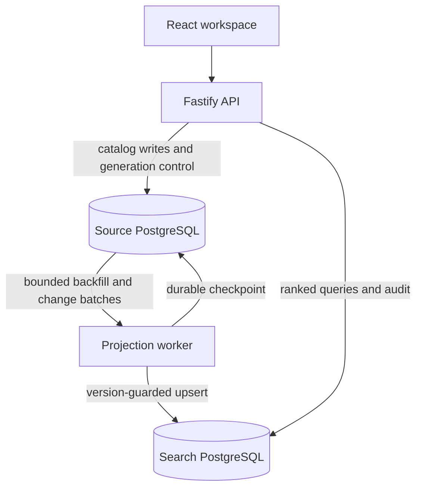

# Index Tide

Search a tenant’s engineering runbooks while their index is being rebuilt. Index Tide keeps a writable PostgreSQL catalog and a separately restartable full-text search database in sync. Operators can inspect lag, build a title-weighted generation, switch readers at a verified checkpoint, and repair an inconsistent page.

[](https://github.com/Karthikvk1899/index-tide/actions/workflows/verify.yml)

## Run the demo

Requires Docker Compose v2, a POSIX shell, and OpenSSL. The initial collection contains 48 generated runbooks in each of two workspaces.

```sh
git clone https://github.com/Karthikvk1899/index-tide.git
cd index-tide
sh scripts/keys.sh
docker compose up -d --build
# Paste the value after the equals sign into the local workspace login.
grep '^OPERATOR_KEY=' .env
```

Open **http://127.0.0.1:8080**. Search for **replica**. Open **Index operations**, build a title-weighted index, wait for zero lag, then activate it. Audit the first page and continue to the next. The reader key opens the same collection with read-only access. The upland key opens the second tenant.

Change the catalog and search for the new text after the worker catches up.

```sh
. ./.env
curl --fail -X PUT http://127.0.0.1:8080/api/v1/documents/501 \
  -H "Authorization: Bearer $OPERATOR_KEY" -H 'Content-Type: application/json' \
  -d '{"title":"Glacier recovery","body":"Validate replica readiness before switching traffic."}'
curl --fail 'http://127.0.0.1:8080/api/v1/search?q=glacier' \
  -H "Authorization: Bearer $READER_KEY"
```

## System design



The source trigger assigns a transactional version under a per-tenant lock. A document mutation and its change envelope commit together. The search engine uses PostgreSQL’s English full-text parser, GIN index, and cover-density ranking in an independent database. Mapping 1 weights title and body equally. Mapping 2 gives titles greater weight. React and TypeScript provide the search and operations views.

A rebuilding generation captures a source watermark and upper document ID under the tenant lock. It pages through current rows, then consumes every committed change after that watermark. Concurrent writes can appear on both paths. The higher version wins, and a retained tombstone prevents stale resurrection. The worker commits the index before acknowledging its source checkpoint. Crashes can replay a batch. Activation locks the tenant and verifies the candidate checkpoint against the committed head.

## Verification

```sh
npm ci
npm test && npm run lint && npm run build
sh scripts/keys.sh
# Use a fresh Compose project for the destructive service-interruption test.
export COMPOSE_PROJECT_NAME=index-tide-check
docker compose --profile test run --build --rm checks
docker compose up -d --build api worker
set -a
. ./.env
set +a
node scripts/recovery.mjs
npx playwright install chromium
npm run browser
docker compose down -v
```

The recovery script stops the search database, accepts a source write, observes an unadvanced checkpoint and a failed search, kills the worker, restarts both services, checks the recovered result, and verifies its deletion. The database suite interleaves writes with backfill, challenges tenant boundaries, replays stale and duplicate versions, injects checkpoint loss and an incompatible envelope, exercises cutover, compares ranking, and repairs missing, changed, and extra keys. Playwright drives the reader and operator experiences through the served production build.

The Compose API binds port 8080 on loopback. Stop an existing demo before starting a separate test project on that port. Use Node.js 24 for local development.

## Engineering scope

- [Consistency, failure behavior and API contracts](docs/contracts.md)
- [Operations and drift-repair exercise](docs/operations.md)
- [Threat model and deployment boundaries](SECURITY.md)
- [MIT license](LICENSE)

The design targets a single-region, small-team reference deployment. Tenant writes serialize, retained history grows, and a hot tenant can delay subsequent worker iterations. Search pagination is live. The demo uses generated static credentials and a trusted private database network. Cloud deployment, failover, restore objectives, representative load, and independent security review require separate evidence.
